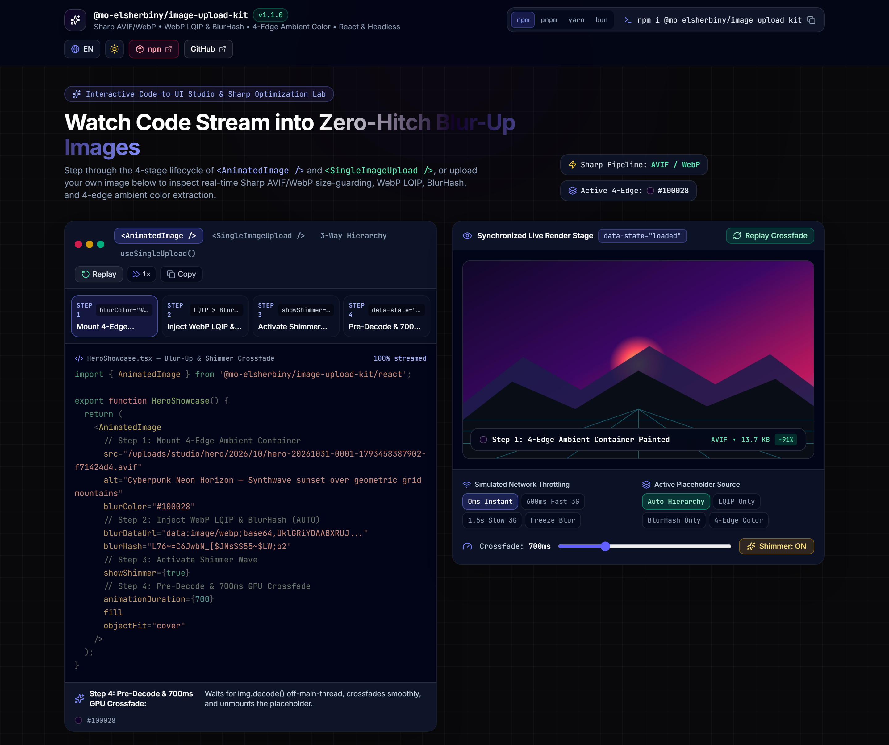
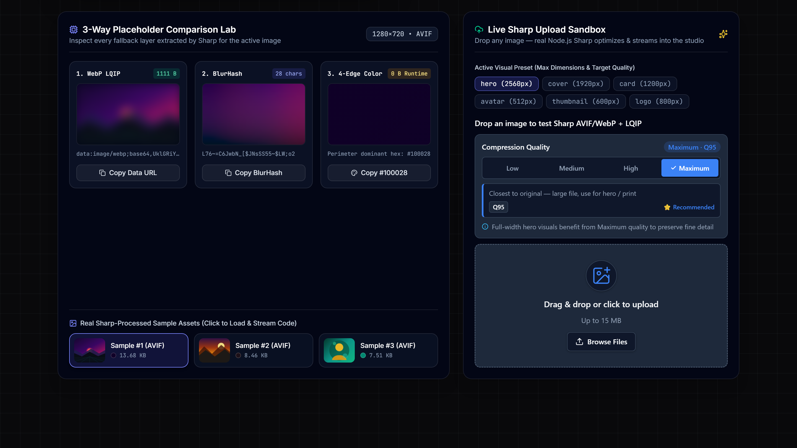

# @mo-elsherbiny/image-upload-kit — Interactive Studio & Blur-Up Lab

Interactive developer showcase and live Sharp optimization sandbox for [`@mo-elsherbiny/image-upload-kit`](https://www.npmjs.com/package/@mo-elsherbiny/image-upload-kit) ([GitHub Repository](https://github.com/MoElsherbiny/image-upload-kit)).





---

## Highlights

1. **Synchronized Code-to-UI Studio (`AnimatedCodeEditor` + `LiveOutputStage`)**:
   - Step through the 4-stage lifecycle of `<AnimatedImage />`, `<SingleImageUpload />`, and `createUploadHttpHandler` (`1. Import` → `2. Mount Placeholder` → `3. Pre-Decode & Crossfade` → `4. Next.js / Full Pipeline`).
   - Syntax-highlighted with **Shiki (`github-dark-Default`)**, auto-play progression, line highlighting, and active line gutter glow synced to the image's 4-edge dominant color.
   - Real-time `<AnimatedImage />` stage with interactive **crossfade duration slider** (`200ms–2000ms`), **shimmer sweep toggle**, **placeholder cascade switcher** (`Auto Cascade` vs `WebP LQIP` vs `BlurHash` vs `4-Edge SVG`), and **DOM Lifecycle Telemetry** (`data-slot`, `data-state`, `aria-busy`, and placeholder unmount status).

2. **3-Way Placeholder Comparison Lab (`BlurLabInspector`)**:
   - Side-by-side visual comparison of **WebP LQIP Data URL** (`< 1 KB`), **Client-Decoded BlurHash Canvas**, and **4-Edge Ambient Color SVG** against the full-resolution optimized asset.
   - One-click JSON payload inspector for the complete `UploadedImageData` contract.

3. **Real-Time In-Browser + Vite Server Sharp Pipeline**:
   - Powered by a custom Vite backend middleware (`server/apiPlugin.ts`) running the real `@mo-elsherbiny/image-upload-kit/server` (`createImageUploader` + `createUploadHttpHandler`) and `@mo-elsherbiny/image-upload-kit/storage` (`createMemoryStorageAdapter`).
   - Drop any PNG, JPEG, WebP, AVIF, or SVG into the live `<SingleImageUpload />` dropzone to watch Sharp AVIF/WebP size-guarding, WebP LQIP generation, BlurHash encoding, and 4-edge dominant color extraction in real time.
   - Switch between standard visual presets (`hero`, `cover`, `card`, `avatar`, `thumbnail`, `logo`, `original`), **Dark / Light theme**, and **English (`ltr`) / Arabic (`rtl`)** localization.

---

## Quick Start

```bash
# 1. Clone the repository
git clone https://github.com/MoElsherbiny/image-upload-kit-demo.git
cd image-upload-kit-demo

# 2. Install dependencies
npm install

# 3. Start the interactive studio (http://localhost:5173)
npm run dev
```

### Build for Production

```bash
npm run build
npm run preview
```

---

## Related Links

- **npm Package**: [`@mo-elsherbiny/image-upload-kit`](https://www.npmjs.com/package/@mo-elsherbiny/image-upload-kit)
- **Core Library Repository**: [`MoElsherbiny/image-upload-kit`](https://github.com/MoElsherbiny/image-upload-kit)
- **Author**: [Mo Elsherbiny](https://www.buildwithsherbo.com/) (`@MoElsherbiny`)

## License

MIT © [Mo Elsherbiny](https://www.buildwithsherbo.com/)
